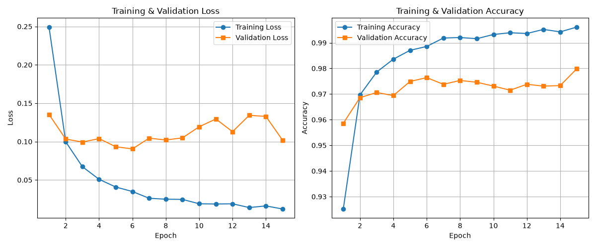
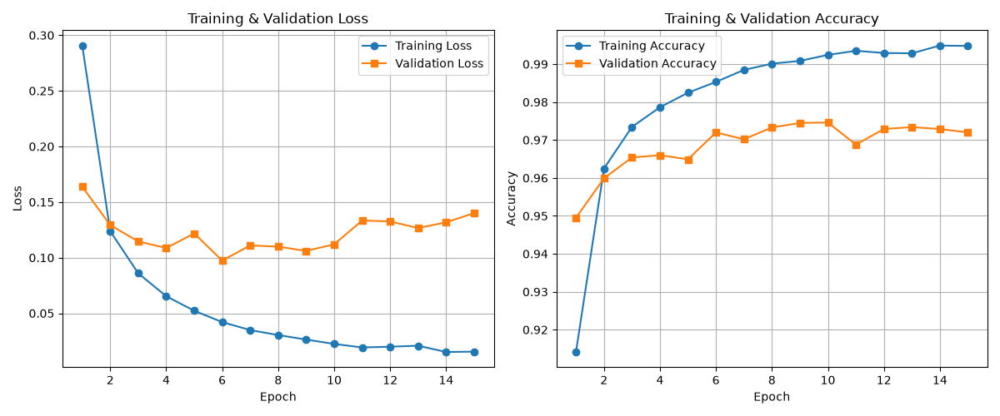

# MNIST Veri Seti ile MLP Tabanlı El Yazısı Rakam Tanıma

Bu proje, MNIST veri kümesini kullanarak Çok Katmanlı Algılayıcı (Multi-Layer Perceptron - MLP) mimarisi ile el yazısı rakamlarını sınıflandırmak ve farklı model yapılandırmalarının performanslarını karşılaştırmak amacıyla geliştirilmiştir. Ayrıca eğitilen modeller, MNIST standartlarına uygun biçimde kendi el yazımla hazırladığım öğrenci numaramın rakam görselleri üzerinde test edilmiştir. Ödev gereksinimi doğrultusunda **CNN kullanılmamıştır.**

## 1. Proje Yapısı

```text
├── data/                        # MNIST veri seti
├── custom_digits/               # Kendi el yazımla hazırladığım rakam görselleri (01.jpeg - 11.jpeg)
├── main.py                      # Birinci modelin eğitim ve değerlendirme kodu
├── predict.py                   # Birinci modelle tahmin kodu
├── main_2.py                    # ikinci modelin eğitim ve değerlendirme kodu
├── predict_2.py                 # İkinci modelle tahmin kodu
├── mlp_mnist_model.pth          # Birinci modelin eğitilmiş ağırlıkları (256-128)
├── accuracy_loss_metrics.png    # Birinci modelin eğitim grafikleri
├── mlp_mnist_model_2.pth        # İkinci modelin eğitilmiş ağırlıkları (128-64)
├── accuracy_loss_metrics_2.png  # İkinci modelin eğitim grafikleri
├── requirements.txt             # Gerekli kütüphaneler
└── README.md                    # Proje raporu
```

## 2. Veri Seti ve Ön İşleme

Projede, 0 ile 9 arasındaki el yazısı rakamlarından oluşan MNIST veri seti kullanılmıştır. Görüntüler 28 × 28 piksel boyutunda ve gri tonlamalıdır.

Veri seti aşağıdaki şekilde ayrılmıştır:

| Veri kümesi | Görüntü sayısı |
|---|---:|
| Eğitim | 50.000 |
| Doğrulama | 10.000 |
| Test | 10.000 |
| **Toplam** | **70.000** |

Görüntüler tensör biçimine dönüştürülmüş ve normalize edilmiştir. Normalizasyon için aşağıdaki dönüşüm kullanılmıştır:

```python
transforms.Normalize((0.1307,), (0.3081,))
```

Eğitim verileri modelin öğrenmesi, doğrulama verileri eğitim sürecindeki performansın izlenmesi ve test verileri nihai başarının değerlendirilmesi için kullanılmıştır. Test verileri model eğitimi ve doğrulama aşamasında kullanılmamıştır.

## 3. Model Mimarileri ve Hiperparametreler

Her iki modelde de 28 × 28 boyutundaki görüntüler düzleştirilerek (Flatten) 784 elemanlı vektörlere dönüştürülmüştür. Çıkış katmanında 0–9 rakamlarını temsil eden 10 nöron bulunmaktadır.

### Deney 1: Büyük MLP (256-128)

- Giriş katmanı: 784 nöron
- Birinci gizli katman: 256 nöron + ReLU
- İkinci gizli katman: 128 nöron + ReLU
- Çıkış katmanı: 10 nöron

### Deney 2: Küçük MLP (128-64)

- Giriş katmanı: 784 nöron
- Birinci gizli katman: 128 nöron + ReLU
- İkinci gizli katman: 64 nöron + ReLU
- Çıkış katmanı: 10 nöron

Her iki deneyde kullanılan temel hiperparametreler:

| Parametre | Değer |
|---|---|
| Optimizasyon algoritması | Adam |
| Öğrenme oranı | 0.001 |
| Eğitim batch size | 64 |
| Epoch sayısı | 15 |
| Kayıp fonksiyonu | CrossEntropyLoss |
| Rastgelelik tohumu | 42 |

## 4. Deney Sonuçları

### Deney 1: Ana Model (256-128)

| Metrik | Değer |
|---|---:|
| Eğitim kaybı (Training Loss) | 0.0122 |
| Doğrulama kaybı (Validation Loss) | 0.1018 |
| Eğitim doğruluğu (Training Accuracy) | %99.61 |
| Doğrulama doğruluğu (Validation Accuracy) | %97.99 |
| Test doğruluğu (Test Accuracy) | %98.23 |
| Eğitim süresi | Yaklaşık 128.10 saniye |

### Deney 2: Küçük Model (128-64)

| Metrik | Değer |
|---|---:|
| Eğitim kaybı (Training Loss) | 0.0155 |
| Doğrulama kaybı (Validation Loss) | 0.1400 |
| Eğitim doğruluğu (Training Accuracy) | %99.48 |
| Doğrulama doğruluğu (Validation Accuracy) | %97.20 |
| Test doğruluğu (Test Accuracy) | %97.42 |
| Eğitim süresi | Yaklaşık 146.10 saniye |

### Loss ve Accuracy Grafikleri

**Deney 1**



**Deney 2**



## 5. Modellerin Karşılaştırılması

| Metrik | Deney 1 (256-128) | Deney 2 (128-64) |
|---|---:|---:|
| Gizli katman nöronları | 256, 128 | 128, 64 |
| Eğitim doğruluğu | %99.61 | %99.48 |
| Doğrulama doğruluğu | %97.99 | %97.20 |
| Test doğruluğu (MNIST) | %98.23 | %97.42 |
| Kendi el yazısı rakamlarımın doğruluğu | %90.91 (10/11) | %45.45 (5/11) |
| Eğitim süresi | 128.10 sn | 146.10 sn |

İlk model, MNIST test doğruluğunda ikinci modelden **0.81 yüzde puan** daha yüksek sonuç elde etmiş, kendi el yazısı görsellerimiz üzerinde de daha başarılı olmuştur.

İkinci model daha az nöron kullanmasına rağmen daha uzun sürede eğitilmiştir. Bu sonuç, eğitim süresinin yalnızca model boyutuna bağlı olmadığını; donanım, çalışma koşulları ve ölçüm farklılıklarından da etkilenebileceğini göstermektedir.

## 6. Kendi El Yazısı Görsellerimin Değerlendirilmesi

Modeller, kendi el yazımla yazdığım 11 haneli öğrenci numaramın (`24120205064`) rakam görselleri üzerinde test edilmiştir. Görseller, MNIST veri setindeki rakamların biçimine benzetilmeye çalışılarak hazırlanmıştır.

Rakamlar ayrı görsellere ayrılmış ve `custom_digits/` klasörüne yerleştirilmiştir. Görseller, tahmin kodunda kullanılan ön işleme adımlarından (grayscale, OTSU thresholding ve 28 × 28 boyutuna yeniden ölçeklendirme) geçirildikten sonra modellere verilmiştir.

### Deney 1 Tahmin Sonuçları — 256-128 MLP

Modelin oluşturduğu tahmin:

```text
24120205062
```

| Dosya adı | Gerçek rakam | Tahmin | Güven skoru | Sonuç |
|---|---:|---:|---:|---|
| 01.jpeg | 2 | 2 | %99.99 | Doğru |
| 02.jpeg | 4 | 4 | %99.02 | Doğru |
| 03.jpeg | 1 | 1 | %95.89 | Doğru |
| 04.jpeg | 2 | 2 | %92.89 | Doğru |
| 05.jpeg | 0 | 0 | %97.90 | Doğru |
| 06.jpeg | 2 | 2 | %100.00 | Doğru |
| 07.jpeg | 0 | 0 | %100.00 | Doğru |
| 08.jpeg | 5 | 5 | %100.00 | Doğru |
| 09.jpeg | 0 | 0 | %100.00 | Doğru |
| 10.jpeg | 6 | 6 | %90.00 | Doğru |
| 11.jpeg | 4 | 2 | %43.47 | Yanlış |

**Doğru tahmin: 10/11 — %90.91**

### Deney 2 Tahmin Sonuçları — 128-64 MLP

Modelin oluşturduğu tahmin:

```text
16510105066
```

| Dosya adı | Gerçek rakam | Tahmin | Güven skoru | Sonuç |
|---|---:|---:|---:|---|
| 01.jpeg | 2 | 1 | %50.68 | Yanlış |
| 02.jpeg | 4 | 6 | %46.86 | Yanlış |
| 03.jpeg | 1 | 5 | %61.89 | Yanlış |
| 04.jpeg | 2 | 1 | %62.34 | Yanlış |
| 05.jpeg | 0 | 0 | %81.23 | Doğru |
| 06.jpeg | 2 | 1 | %75.76 | Yanlış |
| 07.jpeg | 0 | 0 | %99.99 | Doğru |
| 08.jpeg | 5 | 5 | %99.97 | Doğru |
| 09.jpeg | 0 | 0 | %99.05 | Doğru |
| 10.jpeg | 6 | 6 | %97.56 | Doğru |
| 11.jpeg | 4 | 6 | %71.71 | Yanlış |

**Doğru tahmin: 5/11 — %45.45**

**Not:** Güven skoru, modelin seçtiği sınıfa ilişkin tahmin olasılığını gösterir; tahminin doğru olduğunu garanti etmez.

## 7. Genel Değerlendirme ve Tartışma

### MNIST Veri Setindeki Performans

İlk model %98.23, ikinci model ise %97.42 test doğruluğu elde etmiştir. Her iki model de MNIST test kümesindeki rakamları başarılı biçimde sınıflandırmış, daha geniş gizli katman kapasitesine sahip ilk model daha yüksek test doğruluğuna ulaşmıştır.

### Kendi El Yazısı Görsellerimdeki Performans ve Genelleme 

Kendi el yazımla hazırladığım 11 rakam görselinde ilk model %90.91 (10/11), ikinci model ise %45.45 (5/11) doğruluk elde etmiştir.

MNIST test kümesinde iki model arasındaki doğruluk farkı %0.81 puanken, kendi el yazısı görsellerimdeki fark %45.46 puandır. Ancak kendi el yazımın değerlendirmesi yalnızca 11 görsele dayandığı için bu sonuçlar tüm el yazısı örneklerine genellenmemelidir.

Sonuçlar, model mimarisinin ve eğitim sürecinin farklı veri örnekleri üzerindeki performansı etkileyebildiğini göstermektedir. Bununla birlikte, iki deney arasındaki farkın yalnızca nöron sayısından kaynaklandığını söylemek için daha fazla veri ve kontrollü deney gereklidir.

### Distribution Shift ve Ön İşlemenin Etkisi

MNIST veri seti ile kendi el yazısı görsellerim arasındaki biçim, çizgi kalınlığı ve konum farklılıkları distribution shift (veri dağılımı kayması) durumuna örnek oluşturmaktadır. Modellerin standart MNIST veri setindeki yüksek başarımının kendi görsellerimde birebir tekrarlanmaması bu durumla açıklanabilir.

Görsellerin MNIST biçim standartlarına uygun çizilmesi ve OTSU eşikleme, gri tonlama gibi ön işleme adımlarının uygulanması bu kaymanın etkisini minimize etmiş ve ilk modelde %90.91 başarıyı getirmiştir. Ancak değerlendirme yalnızca 11 rakam görseline dayandığı için, genel performans tespiti adına daha fazla veriyle test yapılması gerekmektedir.

### Aşırı Öğrenme (Overfitting)

İkinci deneyde doğrulama kaybı 6. epoch'ta minimum değeri olan 0.0974'e ulaştıktan sonra 15. epoch'ta 0.1400'e yükselmiştir. Eğitim kaybı azalırken doğrulama kaybının artması, modelin eğitim verilerine aşırı uyum sağlamaya başladığının bir göstergesi olabilir.

Bu durumu daha ayrıntılı incelemek için eğitim ve doğrulama kayıplarının birlikte değerlendirilmesi gerekir. Erken durdurma (early stopping) ve en iyi doğrulama sonucuna ait ağırlıkları saklama gibi yöntemler ileride denenebilir.

### Güven Skorlarının Yorumlanması

İkinci model, bazı yanlış tahminlerinde de yüksek güven skorları üretmiştir. Örneğin `06.jpeg` görselindeki gerçek `2` rakamını `%75.76` güven skoru ile `1` olarak sınıflandırmıştır.

Bu durum, modelin yüksek güvenle tahminde bulunmasının her zaman doğru sonuç verdiği anlamına gelmediğini göstermektedir.

### Sonuç

Deney sonuçlarına göre 256-128 mimarisine sahip ilk model, hem MNIST test verilerinde hem de kendi el yazısı görsellerimde 128-64 mimarisine sahip ikinci modelden daha başarılı olmuştur.

Çalışma kapsamında MLP mimarisiyle rakam sınıflandırması yapılmış, farklı gizli katman boyutları karşılaştırılmış ve standart veri kümesindeki başarının kendi el yazısı görsellerimdeki başarıyla her zaman aynı olmayabileceği gözlemlenmiştir.

## 8. Projeyi Çalıştırma

### Gerekli Kütüphanelerin Yüklenmesi

```bash
pip install -r requirements.txt
```

### Birinci Model ile Tahmin Yapma

Eğitilmiş ağırlıkları yeniden kullanarak kendi el yazısı rakam görsellerimde tahmin yapmak için:

```bash
python predict.py
```

Tahmin işleminin çalışabilmesi için `predict.py`, `mlp_mnist_model.pth` ve `custom_digits/` klasörünün gerekli dosyalarla birlikte mevcut olması gerekir.

### Birinci Modeli Yeniden Eğitme

Modeli sıfırdan eğitmek ve ağırlık dosyasını yeniden oluşturmak için:

```bash
python main.py
```

### İkinci Model ile Tahmin Yapma

Eğitilmiş ağırlıkları yeniden kullanarak kendi el yazısı rakam görsellerimde tahmin yapmak için:

```bash
python predict_2.py
```
Tahmin işleminin çalışabilmesi için `predict_2.py`, `mlp_mnist_model_2.pth` ve `custom_digits/` klasörünün gerekli dosyalarla birlikte mevcut olması gerekir.

### İkinci Modeli Yeniden Eğitme

Modeli sıfırdan eğitmek ve ağırlık dosyasını yeniden oluşturmak için:

```bash
python main_2.py
```

## 9. Kullanılan Kütüphaneler

- **PyTorch:** Model mimarisi, kayıp fonksiyonları ve optimizasyon
- **Torchvision:** MNIST veri setini yükleme ve tensör dönüşümleri
- **OpenCV (cv2):** Görsellerin gri tonlama ve OTSU eşikleme (thresholding) ön işlemleri
- **Pillow (PIL):** Görüntü okuma ve yeniden boyutlandırma
- **NumPy:** Dizi işlemleri ve veri düzenleme
- **Matplotlib:** Eğitim/doğrulama doğruluğu ve kayıp grafiklerinin çizimi
